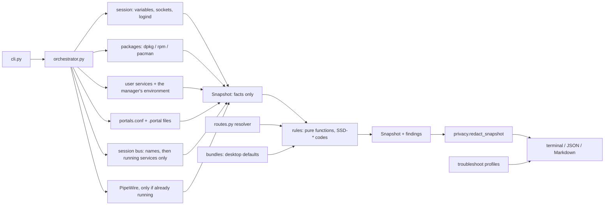

# Architecture

Screenshare Doctor is split into layers that only talk in one direction. Collectors gather facts, rules turn facts
into findings, renderers turn findings into output. Nothing below the CLI decides what the user wanted, and nothing
above the collectors runs a command or reads a file.

## Layers

| Layer | Modules | Rule |
| --- | --- | --- |
| CLI | `cli.py` | Parses arguments, chooses what to collect, sets exit codes. No diagnosis. |
| Orchestration | `orchestrator.py` | Runs the collectors in order and builds the snapshot; `diagnose()` adds findings. |
| Collectors | `collectors/` | Read facts; never decide what they mean. A failed probe becomes a `ProbeFailure`. |
| Snapshot | `models.py` | Frozen dataclasses. Unknown facts are `None`; conclusions are recomputed, not stored. |
| Interpretation | `desktops.py`, `session.py`, `keyfile.py`, `portal_files.py`, `portal_paths.py`, `routes.py` | Pure functions that read facts the way the system's own components do. |
| Data | `bundles/desktops.json`, `troubleshoot/*.json` | Desktop defaults and app hints, each with its source. |
| Rules | `rules/` | Pure functions of a snapshot, registered under `SSD-*` codes with a docstring and a layer. |
| Privacy | `privacy.py` | Redacts the whole snapshot before any renderer sees it. |
| Renderers | `reports/` | Terminal (never Rich markup from collected text), JSON (schema v1), Markdown (escaped). |

## Passive by construction

Every command goes through a `CommandRunner`, so tests can replace it, and the real one enforces an argument list
(never a shell), a timeout, an output cap and `LC_ALL=C`. What the tool may run is one allowlist, tested in
`tests/contract/test_passive_harness.py`. Three rules keep a check from changing what it checks:

1. **D-Bus in two steps.** The bus daemon is asked which names run (`NameHasOwner`) and which could start
   (`ListActivatableNames`); it never starts a service to answer. Only names that already run are then contacted,
   with `busctl --auto-start=no`, so even one that stopped in between fails instead of starting.
2. **No socket activation.** With systemd, the first connection to `pipewire.socket` starts PipeWire, so `pw-dump`
   runs only when `pipewire.service` is already active.
3. **The portal's view, not the shell's.** Portals are started by the user manager and read its environment, so
   desktop names and search directories come from `systemctl --user show-environment`, reduced to an allowlist.

## Reading the system the way it reads itself

- `desktops.py` splits `XDG_CURRENT_DESKTOP` and drops invalid entries exactly as xdg-desktop-portal does.
- `keyfile.py` follows GLib's key-file rules where they decide outcomes: a duplicate key keeps its last value, a bad
  line makes the whole file unreadable.
- `routes.py` re-implements the portal's backend selection **per release**, because the rules changed in 1.17,
  1.19, 1.20.1 and 1.21.1 (see [portal routing](portal-routing.md)). Its prediction is then compared with the bus:
  configured is not the same as working.

## Findings

A finding has a status (pass, warn, fail, unknown, not applicable, not tested), a severity, a confidence, the layer
it is about, its evidence, a recommended action that is only ever printed, a command to verify the result, its
limitations, and optionally `caused_by`: the root cause it follows from. Renderers fold such findings under their
cause, so an unreachable session bus is one problem, not ten.

`troubleshoot screenshare` reuses the same findings: a symptom profile orders the relevant checks, an app profile adds
sourced hints. Nothing is re-checked per symptom.
